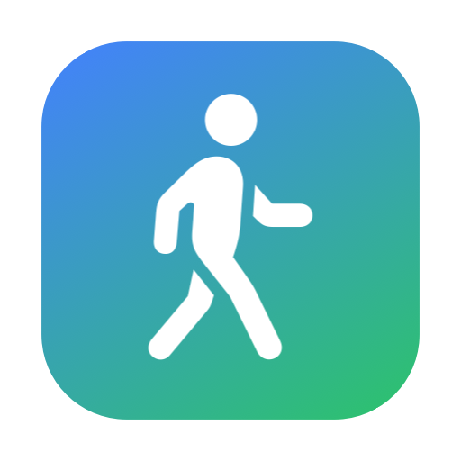
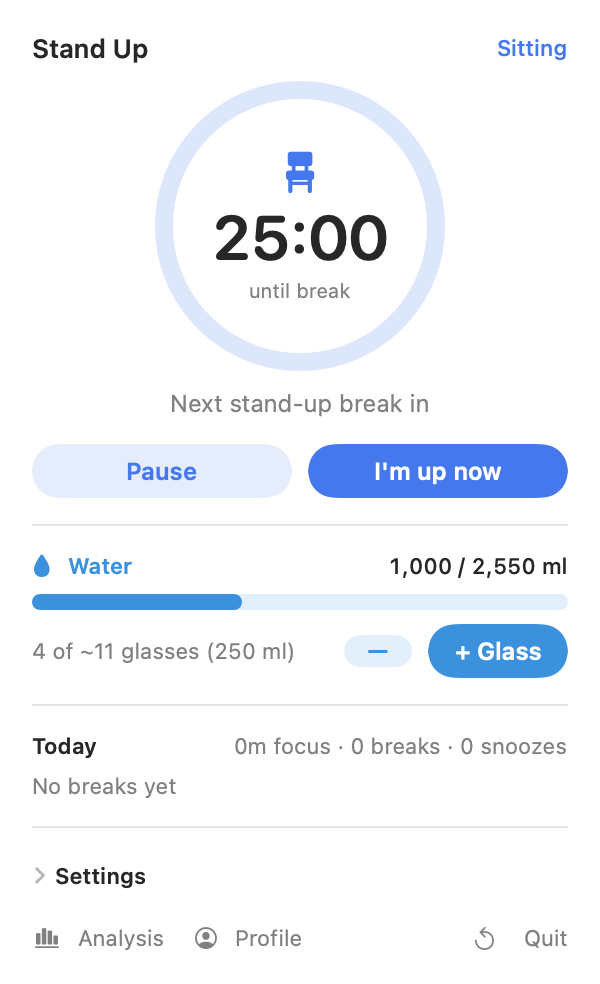
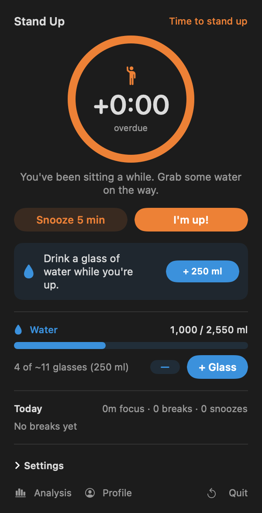
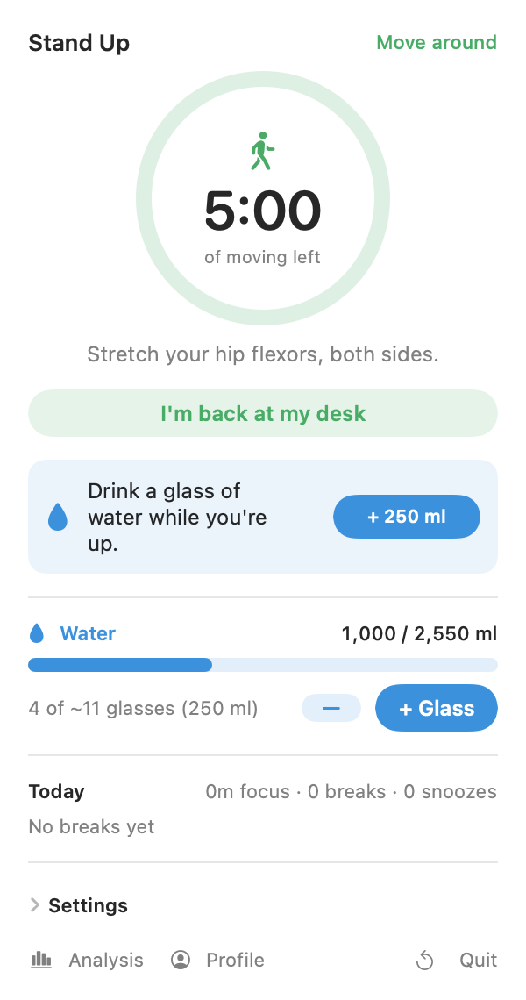
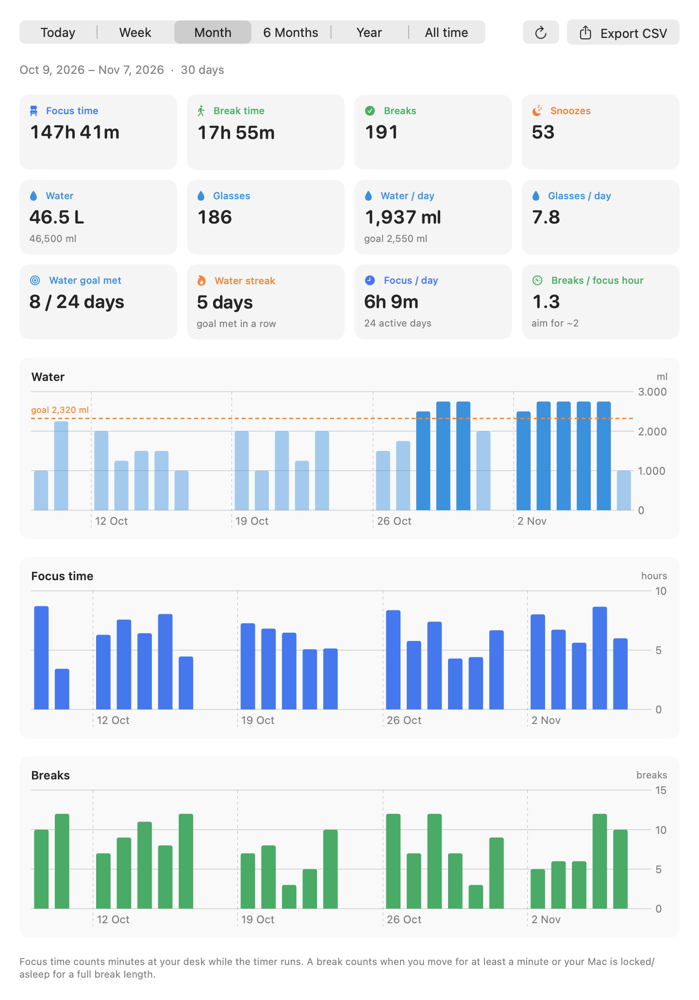
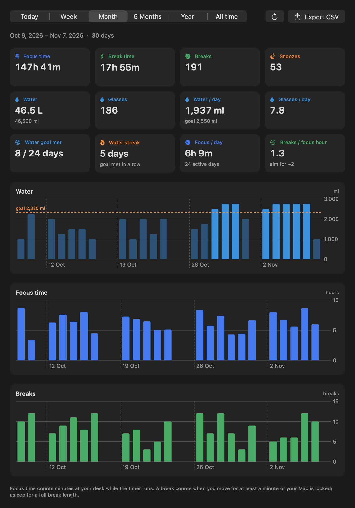
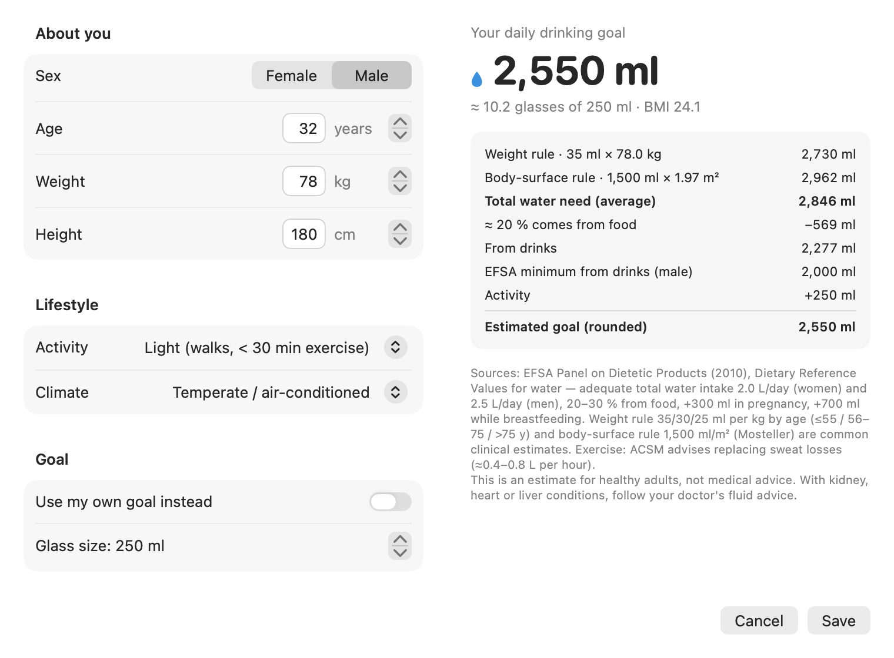

<p align="center">
  
</p>

<h1 align="center">Stand Up</h1>

<p align="center">
  <b>A tiny macOS menu bar app that gets you off the chair and keeps you hydrated.</b><br>
  Free · open source · no ads · no account · your data never leaves your Mac
</p>

<p align="center">
  <a href="https://github.com/yskarakas/StandUp/releases/latest"><b>⬇︎ Download the latest version</b></a>
  &nbsp;·&nbsp; macOS 13 or newer &nbsp;·&nbsp; Apple silicon &amp; Intel
</p>

<p align="center">
  
  &nbsp;
  
  &nbsp;
  
</p>

---

## Why

Long, uninterrupted sitting is linked to higher blood pressure, worse blood-sugar control and lower brain blood flow — and an evening at the gym doesn't fully undo it. Studies point to a simple fix: **get up and move for a few minutes every half hour**, and drink enough water while you're at it.

Stand Up turns that into a habit with as little friction as possible: it lives in the menu bar, stays out of your way while you work, and taps you on the shoulder every 25 minutes.

## How it works

1. **Sit & focus.** A chair icon in the menu bar shows the minutes left (e.g. `21m`).
2. **Time to stand up.** After 25 minutes a soft chime plays, the icon turns orange and the panel opens by itself — without stealing focus from the window you're typing in.
3. **Move.** Press **I'm up!** and a 5-minute move break starts, with a small tip (stretch, stairs, calf raises…) and a nudge to drink a glass of water. Not a good moment? **Snooze 5 min.**
4. **Back to work.** When the break ends, the sitting timer starts again automatically.

If you ignore the reminder, it chimes again gently every 5 minutes. If you lock your screen or put your Mac to sleep for at least a full break, that counts as a break and the timer starts fresh when you come back.

## Features

| | |
|---|---|
| 🪑 **Menu bar timer** | Icon only, minutes (`12m`) or minutes:seconds (`12:34`). Click for the panel, **right-click for quick actions** (log a glass, I'm up, snooze, pause, analysis…). |
| 🔔 **Stand-up reminder** | Chime + orange icon + the panel pops up on its own. Everything adjustable: sitting time (5–120 min), break length, snooze length, sounds on/off. |
| 🚶 **Move breaks** | Countdown with a short movement tip. A break counts once you've moved for at least a minute. |
| 💧 **Water tracker** | One-click **+ Glass** (glass size configurable, default 250 ml), undo, progress bar towards your daily goal and a celebration chime when you reach it. Every break reminds you to drink. |
| 🧮 **Personal water goal** | Enter sex, age, weight, height, activity and climate — the app shows a transparent, step-by-step estimate based on published guidelines (see below). You can also set your own goal. |
| 📊 **Analysis** | Today · Week · Month · 6 Months · Year · All time. Focus time, break time, breaks, snoozes, water in litres and glasses, daily averages, days the water goal was met, water streak, breaks per focus hour, and charts. |
| 📄 **CSV export** | Export your full history to a spreadsheet. |
| 🌙 **Light & dark mode** | Follows your system appearance. |
| 🚀 **Launch at login** | One switch in Settings. |
| 🪶 **Lightweight** | Native Swift (AppKit + SwiftUI), no dependencies, one 1-second timer, no background animations. ~0 % CPU and ~15 MB of memory while idle. |

## Analysis

<p align="center">
  
</p>

Pick a period at the top and you get:

- **Focus time** – minutes at your desk while the timer runs (total and per active day)
- **Break time** and number of **breaks**, plus how often you **snoozed**
- **Water** – total litres, glasses, average ml and glasses per day
- **Water goal met** – on how many days you reached your goal, and your current **streak**
- **Breaks per focus hour** – aim for about two
- Charts for water, focus time and breaks. Week and Month show each day; 6 Months, Year and All time show daily averages per week or month.

<details>
<summary>Dark mode</summary>
<p align="center"></p>
</details>

## Your personal water goal

<p align="center">
  
</p>

The first time you open Stand Up it asks for a few details and calculates how much you should **drink** per day:

1. **Weight rule** – 35 ml per kg (age ≤ 55), 30 ml/kg (56–75), 25 ml/kg (> 75).
2. **Body-surface rule** – 1,500 ml per m² of body surface area (Mosteller formula, uses height and weight).
3. The **average of both** is your total daily water need. About **20 % of it comes from food** (EFSA 2010), the rest from drinks.
4. The result is never lower than the **EFSA adequate intake from drinks**: 2.0 L for men and 1.6 L for women.
5. **Extras:** activity +250 / +500 / +1,000 ml (based on ACSM sweat-replacement guidance), warm or hot climate +250 / +500 ml, pregnancy +300 ml, breastfeeding +700 ml (EFSA).

The final value is rounded to 50 ml. Example: a 32-year-old man, 78 kg, 180 cm, lightly active → **2,550 ml/day** (≈ 10 glasses of 250 ml).

> This is an estimate for healthy adults, not medical advice. If you have kidney, heart or liver conditions, follow your doctor's fluid advice.

**References**

- EFSA Panel on Dietetic Products, Nutrition and Allergies (2010). *Scientific Opinion on Dietary Reference Values for water.* EFSA Journal 8(3):1459.
- Mosteller R.D. (1987). *Simplified calculation of body-surface area.* N Engl J Med 317:1098.
- American College of Sports Medicine (2007). *Exercise and fluid replacement* (position stand). Med Sci Sports Exerc 39(2):377–390.

## Download & install

1. Download **StandUp-1.1-macOS.zip** from the [latest release](https://github.com/yskarakas/StandUp/releases/latest).
2. Double-click the zip and drag **Stand Up.app** into your **Applications** folder.
3. Open it. The app is free and not signed with a paid Apple developer account, so macOS shows a warning the first time:
   - **macOS 15 or newer:** click **Done**, open **System Settings → Privacy & Security**, scroll down and click **Open Anyway** next to “Stand Up”, then confirm.
   - **macOS 13–14:** right-click (or Control-click) the app, choose **Open**, then click **Open** again.

   You only need to do this once. Or run this in Terminal instead:
   ```bash
   xattr -dr com.apple.quarantine "/Applications/Stand Up.app"
   ```
4. A chair icon appears in the menu bar. Fill in your profile, and you're set.

**Tip:** turn on **Launch at login** in Settings so it's always there.

## Build from source

Requires macOS 13+ and the Xcode command line tools (`xcode-select --install`).

```bash
git clone https://github.com/yskarakas/StandUp.git
cd StandUp
./build.sh --install   # build, copy to /Applications and launch
```

| Command | What it does |
|---|---|
| `./build.sh` | Builds `Stand Up.app` for this Mac next to the script |
| `./build.sh --install` | Builds, installs to `/Applications` and launches |
| `./build.sh --release` | Universal build (Apple silicon + Intel), zipped into `dist/` |

### Project layout

```
Sources/
  main.swift          app entry, menu bar item, right-click menu, windows
  Model.swift         timer logic, water log, settings, away detection
  Store.swift         day-by-day history (JSON) and CSV export
  Hydration.swift     profile and water-goal calculation
  PopoverView.swift   the menu bar panel
  AnalysisView.swift  statistics and charts
  ProfileView.swift   profile form and goal breakdown
make_icon.swift       draws the app icon
build.sh              build / install / release script
```

## Privacy

Everything stays on your Mac. History is stored in `~/Library/Application Support/StandUp/history.json`, settings in the app's user defaults. No network access, no analytics, no account.

## Uninstall

Right-click the menu bar icon → **Quit Stand Up**, then delete `/Applications/Stand Up.app` and the folder `~/Library/Application Support/StandUp`.

## Inspiration

Inspired by Barış Özcan's article [“Oturmak yeni sigara mı?”](https://barisozcan.com/yazi/oturmak-yeni-sigara-mi/) on why short, regular movement breaks matter.

## License

[MIT](LICENSE) © 2026 Y. Selim Karakas
